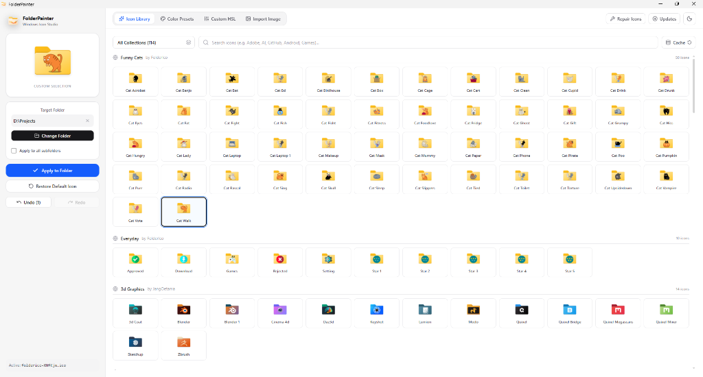

<div align="center">


# FolderPainter

**Modern, open-source Windows folder customization studio.**  
Transform default yellow directories into organized, color-coded, and beautifully themed workspaces.

[](LICENSE)
[](https://microsoft.com/windows)
[](https://tauri.app)
[](https://rust-lang.org)
[](https://react.dev)
[](https://typescriptlang.org)
[](https://tailwindcss.com)

<br />



</div>

---

## Overview

**FolderPainter** is a desktop application engineered to replace proprietary folder icon utilities with a free, open-source, and privacy-respecting tool. Built on **Tauri 2** and **Rust**, it integrates directly with the native Windows Shell API to deliver instant, persistent icon modifications without background processes or system overhead.

---

## Key Features

### 1. Curated Icon Catalog (114 Collections)
- **5,000+ High-Fidelity Icons:** Curated collections including Funny Cats, Everyday, 3D Graphics, System Tools, Developer Stacks, and Multimedia.
- **Instant Search & Filtering:** Filter by collection author or query tags with real-time debounced search.
- **Two-Tier Asset Caching:** High-speed IndexedDB and local file caching with infinite scroll loading.
- **Safe Cache Management:** Purge cache anytime with modal confirmation and keyboard dismissal.

### 2. Procedural Color & HSL Studio
- **13 Windows Explorer Presets:** Calibrated shades (Cobalt Blue, Emerald Green, Crimson Red, Sunflower Yellow, Violet, Slate) optimized for high contrast against Explorer backgrounds.
- **Dynamic HSL Wheel:** Procedural color generator rendering bespoke folder icons for any Hue, Saturation, and Lightness combination.
- **Custom Image Converter:** Convert arbitrary PNG, JPG, JPEG, WebP, or BMP images into multi-resolution `.ico` binaries preserving transparency and aspect ratios.

### 3. Tree Recursion & Shell Maintenance
- **Apply to All Subfolders:** Toggle recursive processing to update entire directory trees in a single atomic action.
- **Windows Icon Cache Repair:** Built-in repair utility to purge corrupted `IconCache.db` and Explorer thumbnail databases, issuing a shell-wide `SHCNE_ASSOCCHANGED` broadcast to force instant icon repaints.
- **Atomic Desktop.ini Merging:** Preserves existing folder metadata (`[ViewState]`, localized folder names) while editing only the `[.ShellClassInfo]` section.

### 4. Native Undo, Redo & Modern UI
- **Persistent History:** Automatically saves mutation logs to disk across restarts.
- **1:1 Authentic Previews:** Live preview card mirrors true Windows 10/11 folder geometry (back tab, paper sheet inserts, front flap).
- **Executive Dark & Light Theming:** Native Windows DWM titlebar synchronization with custom 6px translucent floating scrollbars.
- **Cryptographic Auto-Updater:** Seamless in-app updates verified via Ed25519/Minisign signatures.

---

## Technical Architecture

FolderPainter pairs a React 19 frontend with a Rust backend connected via Tauri 2 IPC channels:

```
FolderPainter/
├── docs/                             # Documentation assets and screenshots
│   └── screenshot.png
├── src/                              # Frontend (React 19 + TypeScript + Tailwind v4)
│   ├── assets/                       # Branding logos and vector graphics
│   ├── components/                   # Modular UI components
│   │   ├── CachedIconImage.tsx       # IndexedDB and HTTP image cache renderer
│   │   ├── ColorWheel.tsx            # Interactive procedural HSL color picker
│   │   ├── CustomIconTab.tsx         # Drag-and-drop image-to-ICO converter
│   │   ├── IconGrid.tsx              # Authentic 3D folder rendering component
│   │   └── IconLibraryTab.tsx        # Infinite-scrolling catalog browser
│   ├── hooks/                        # Custom React state machines
│   │   ├── useFolderIcon.ts          # Core icon assignment & undo/redo logic
│   │   ├── useTheme.ts               # Theme synchronizer (Light/Dark/System)
│   │   └── useUpdater.ts             # Cryptographic auto-update lifecycle
│   ├── lib/                          # Type definitions and Tauri IPC invoke wrappers
│   └── styles.css                    # Tailwind CSS v4 styling and custom scrollbar definitions
├── src-tauri/                        # Backend (Rust + Win32 Shell API)
│   ├── src/
│   │   ├── commands/                 # Tauri IPC command controllers
│   │   │   ├── color_icons.rs        # Procedural HSL generator and multi-res ICO builder
│   │   │   ├── folder_icon.rs        # Directory traversal & icon assignment
│   │   │   ├── icon_convert.rs       # Image rasterization to ICO format
│   │   │   ├── icon_library.rs       # Local catalog indexer & download cache
│   │   │   ├── icon_repair.rs        # Windows Explorer shell cache repair
│   │   │   ├── undo.rs               # Persistent undo/redo state manager
│   │   │   └── window_theme.rs       # Windows DWM titlebar dark mode bridge
│   │   ├── shell/                    # Win32 FFI and filesystem operations
│   │   │   ├── attributes.rs         # Win32 SetFileAttributesW (System / ReadOnly)
│   │   │   ├── desktop_ini.rs        # INI parser and [.ShellClassInfo] writer
│   │   │   └── notify.rs             # Win32 SHChangeNotify shell broadcasting
│   │   └── lib.rs                    # Application entry point and plugin registration
│   ├── nsis/                         # Custom branded NSIS installer headers and banners
│   └── tauri.conf.json               # Tauri 2 configuration manifest
```

---

## Win32 Shell Protocol

Windows Explorer renders custom folder glyphs based on a four-stage shell protocol:

| Step | Mechanism | Implementation |
|---|---|---|
| **1. Configuration** | `desktop.ini` creation | Writes `[.ShellClassInfo] IconResource=path\to\icon.ico,0` |
| **2. Hidden Attributes** | File security flags | Sets `FILE_ATTRIBUTE_HIDDEN` and `FILE_ATTRIBUTE_SYSTEM` on `desktop.ini` |
| **3. Directory Attribute** | Folder dispatch flags | Assigns `FILE_ATTRIBUTE_SYSTEM` on the target directory (`SetFileAttributesW`) |
| **4. Shell Invalidation** | Explorer cache refresh | Broadcasts `SHCNE_UPDATEITEM`, `SHCNE_UPDATEDIR`, and `SHCNE_ASSOCCHANGED` |

---

## Getting Started

### Prerequisites

- **Windows:** Windows 10 (Build 19041+) or Windows 11 (x64 / ARM64)
- **Node.js:** v18.0.0 or higher
- **Rust Toolchain:** v1.75.0 or higher (`rustup default stable`)
- **Visual Studio Build Tools:** C++ build tools workload (for MSVC linking)

### Installation & Development

```powershell
# Clone the repository
git clone https://github.com/sizwinz/FolderPainter.git
cd FolderPainter

# Install frontend dependencies
npm install

# Run in development mode with hot reload
npm run tauri dev
```

### Building Release Installers

To compile optimized release binaries with NSIS installer generation:

```powershell
npm run tauri build
```

Compiled deliverables will be located in:
- **NSIS Installer:** `src-tauri/target/release/bundle/nsis/FolderPainter_0.1.0_x64-setup.exe`
- **Standalone Binary:** `src-tauri/target/release/FolderPainter.exe`

---

## Testing & Quality Assurance

FolderPainter includes automated unit test suites covering the Win32 shell integration, INI parsing, procedural ICO encoders, and undo history stacks:

```powershell
# Run backend test suite
cd src-tauri
cargo test

# Run frontend TypeScript and bundle checks
cd ..
npm run build
```

---

## Contributing

Contributions, bug reports, and suggestions are welcome. Please open an issue or pull request on GitHub.

1. Fork the Project
2. Create your Feature Branch (`git checkout -b feature/AmazingFeature`)
3. Commit your Changes (`git commit -m "feat: add AmazingFeature"`)
4. Push to the Branch (`git push origin feature/AmazingFeature`)
5. Open a Pull Request

---

## License

Distributed under the **MIT License**. See [`LICENSE`](LICENSE) for more information.
